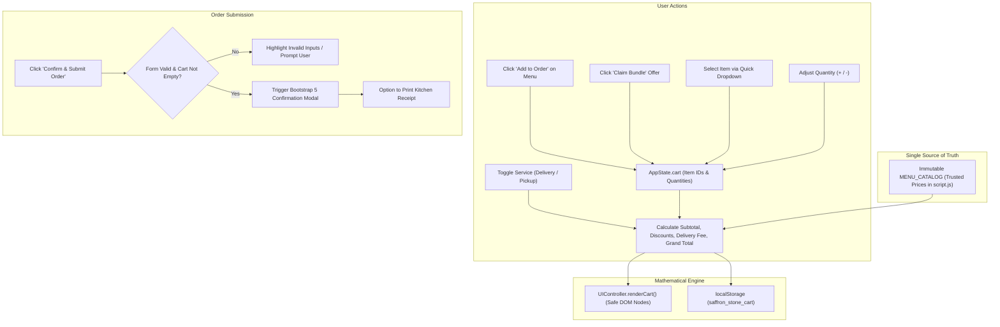

# 🍽️ Saffron & Stone Kitchen — Online Food Ordering Website

<div align="center">


<p align="center">
  <strong>An art-directed, responsive, and accessible online food ordering single-page application built for university Web Engineering.</strong><br>
  <em>Artisanal Heritage Dining • Wood-Fired Hearth Classics • Live Shopping Cart • Dynamic Price Engine</em>
</p>

[🚀 Live Preview Guide](#-quick-start--how-to-run) • [📸 Visual Tour](#-interactive-visual-tour) • [📐 Architecture & Flow](#-system-architecture--data-flow) • [🧪 Test Matrix](#-quality-assurance--testing-matrix) • [📄 Academic Report](report.pdf)

</div>

---

## 📑 Interactive Table of Contents

<details open>
<summary><strong>Click to toggle Table of Contents</strong></summary>

- [✨ Project Overview & Brand Identity](#-project-overview--brand-identity)
- [📐 System Architecture & Data Flow](#-system-architecture--data-flow)
- [📸 Interactive Visual Tour](#-interactive-visual-tour)
- [🍕 Master Menu Catalog & Pricing](#-master-menu-catalog--pricing)
- [⚙️ Technical Feature Breakdown](#️-technical-feature-breakdown)
  - [1. Single Source of Truth Pricing](#1-single-source-of-truth-pricing)
  - [2. Dynamic Calculation Formula](#2-dynamic-calculation-formula)
  - [3. Form Validation & XSS Prevention](#3-form-validation--xss-prevention)
  - [4. Dark & Light Mode Engine](#4-dark--light-mode-engine)
- [🚀 Quick Start & How to Run](#-quick-start--how-to-run)
- [🧪 Quality Assurance & Testing Matrix](#-quality-assurance--testing-matrix)
- [📂 Complete File Structure](#-complete-file-structure)
- [🔒 Security & Academic Disclaimers](#-security--academic-disclaimers)

</details>

---

## ✨ Project Overview & Brand Identity

**Saffron & Stone Kitchen** departs from generic AI landing pages or template reproductions. It models an authentic independent restaurant that fuses ancient wood-fired hearth cooking with contemporary Pakistani-Mediterranean gastronomy.

### 🎨 Design System & Color Tokens
All styling is driven by CSS Custom Properties (`style.css`):

| Color Token | Hex Code | Visual Swatch | Implementation Role |
| :--- | :--- | :---: | :--- |
| `--color-ivory` | `#F8F5EE` | 🟨 | Warm heritage background & clean card surfaces |
| `--color-forest` | `#193B2E` | 🟩 | Brand core green, primary headers, dark cards |
| `--color-orange` | `#D96B3B` | 🟧 | High-visibility CTAs, badges, interactive states |
| `--color-sage` | `#DCE5D8` | 🩵 | Subtle dividers, soft secondary pills, borders |
| `--color-dark` | `#252923` | ⬛ | High-contrast body typography (WCAG AA compliant) |
| `--color-muted` | `#6D7169` | 🔲 | Secondary descriptions, timestamps, metadata |

### 🔤 Typography Hierarchy
- **Primary Serif:** `DM Serif Display` (Google Fonts) — Editorial character, traditional artisanal warmth.
- **Primary Sans:** `DM Sans` (Google Fonts) — Clean, modern, highly legible controls and numbers.
- **Fallback Stack:** `-apple-system, BlinkMacSystemFont, 'Segoe UI', Roboto, Helvetica, Arial, sans-serif`.

---

## 📐 System Architecture & Data Flow

The diagram below illustrates how user interactions flow through the application state, calculation engine, and DOM controller:



---

## 📸 Interactive Visual Tour

<details open>
<summary><strong>Click to expand / collapse full screenshot gallery</strong></summary>

### 1. Desktop Hero & Navigation
> *Status announcement bar with live date, brand wordmark, editorial headline, value pillars, and asymmetrical photography.*


---

### 2. Handcrafted Food Menu & Live Search
> *Instant search input, category filter pills (All, Mains, Handhelds, Sides & Drinks), and priced food cards.*


---

### 3. Special Promotional Bundles
> *Curated combos (The Saffron Feast Bundle & Artisan Lunch Express) with calculated savings and one-click order buttons.*


---

### 4. Interactive Order Form & Live Shopping Cart
> *Customer details, delivery/pickup toggle, quick item dropdown, dynamic line subtotals, and free-delivery progress bar.*


---

### 5. Order Confirmation Receipt Modal
> *Bootstrap 5 dialog showing simulated order ID (#SFS-2026-XXXX), customer details, itemized table, and print button.*


---

### 6. Theme Switching & Mobile Viewports
<div align="center">
  <table>
    <tr>
      <th align="center">🌙 Dark Mode Experience</th>
      <th align="center">📱 Mobile Responsive View (390px)</th>
    </tr>
    <tr>
      <td align="center"></td>
      <td align="center"></td>
    </tr>
  </table>
</div>

</details>

---

## 🍕 Master Menu Catalog & Pricing

All prices are defined in **Pakistani Rupees (PKR - Rs.)** inside `script.js` as an immutable source of truth:

| Item Identifier | Dish Name | Category | Local Asset | Unit Price (PKR) | Special Culinary Highlights |
| :---: | :--- | :---: | :---: | :---: | :--- |
| `burger-01` | **Artisan Wagyu Smash Burger** | `handhelds` | `images/burger.jpg` | **Rs. 1,450** | Double grass-fed beef smash patties, aged cheddar, saffron aioli, toasted brioche. |
| `pizza-01` | **Wood-Fired Truffle Pizza** | `mains` | `images/pizza.jpg` | **Rs. 1,850** | 48-hour fermented sourdough crust, San Marzano pomodoro, buffalo mozzarella, white truffle oil. |
| `pasta-01` | **Wild Mushroom Fettuccine** | `mains` | `images/pasta.jpg` | **Rs. 1,650** | Fresh rolled egg fettuccine, porcini-shiitake cream sauce, garden thyme, Parmigiano-Reggiano. |
| `sandwich-01` | **Smoked Sourdough Sandwich** | `handhelds` | `images/sandwich.jpg` | **Rs. 1,150** | Hickory-smoked chicken breast, avocado, crisp greens, vine tomatoes, stoneground herb Dijon. |
| `fries-01` | **Rosemary Parmesan Fries** | `sides` | `images/fries.jpg` | **Rs. 650** | Double-fried Russet potatoes tossed with fresh rosemary, Himalayan pink salt, aged parmesan. |
| `drink-01` | **Botanical Saffron Cooler** | `sides` | `images/drink.jpg` | **Rs. 450** | Handcrafted sparkling cooler with blood orange, fresh mint leaves, wild cardamom, saffron cordial. |

### 🎁 Promotional Combo Packages
- **The Saffron Feast Bundle:** Truffle Pizza + Wagyu Burger + Parmesan Fries + 2 Botanical Coolers.  
  *Regular:* `Rs. 4,400` &rarr; **Special Bundle Price: `Rs. 3,850` (Save Rs. 550)**
- **Artisan Lunch Express:** Sourdough Sandwich + Parmesan Fries + Botanical Cooler.  
  *Regular:* `Rs. 2,250` &rarr; **Special Combo Price: `Rs. 1,650` (Save Rs. 600)**

---

## ⚙️ Technical Feature Breakdown

<details>
<summary><strong>1. Single Source of Truth Pricing (Click to view code)</strong></summary>

Product pricing is **never** extracted from editable DOM elements or user-controllable input fields. Totals are derived from `MENU_CATALOG`:

```javascript
// snippet from script.js
const MENU_CATALOG = Object.freeze({
  'burger-01': { id: 'burger-01', name: 'Artisan Wagyu Smash Burger', price: 1450, ... },
  'pizza-01':  { id: 'pizza-01',  name: 'Wood-Fired Truffle Pizza',       price: 1850, ... },
  // ...
});
```

</details>

<details>
<summary><strong>2. Dynamic Calculation Formula (Click to view formula)</strong></summary>

$$\text{Subtotal} = \sum_{i \in \text{Cart}} (\text{Catalog\_Price}[i] \times \text{Quantity}[i])$$

$$\text{Delivery Fee} = \begin{cases} 
0 & \text{if Service} = \text{'pickup'} \\
0 & \text{if Subtotal} \ge \text{Rs. 3,000 or Subtotal} = 0 \\
\text{Rs. 150} & \text{otherwise}
\end{cases}$$

$$\text{Grand Total} = \max(0, \text{Subtotal} - \text{Discount} + \text{Delivery Fee})$$

</details>

<details>
<summary><strong>3. Form Validation & XSS Prevention (Click to view details)</strong></summary>

- **XSS Prevention:** Dynamic cart rows and modal tables are rendered using `document.createElement()` and `textContent`. No user-supplied strings are ever injected via raw `innerHTML`.
- **Constraint Validation:** Form inputs utilize HTML5 attributes (`required`, `type="email"`, `pattern="^(\+92|0)[0-9]{2,3}-?[0-9]{7}$"`, `minlength="3"`).
- **Bootstrap Feedback:** Form submission triggers `.was-validated`, displaying visual indicators and localized validation messages.

</details>

<details>
<summary><strong>4. Dark & Light Mode Engine (Click to view details)</strong></summary>

- Controls `data-bs-theme="light|dark"` attribute on the root `<html>` element.
- Automatically saves and restores the user's preferred theme via `localStorage.getItem('saffron_stone_theme')`.
- All CSS variables dynamically adapt contrast, background, and borders.

</details>

---

## 🚀 Quick Start & How to Run

No build tools, compilation steps, or external dependencies are required.

### Method 1: Instant Browser Launch (Recommended)
1. Navigate to the project directory: `d:\E Com` or `d:\E Com\OnlineFoodOrdering`.
2. Double-click **`index.html`** to open it directly in any modern browser (Chrome, Edge, Firefox, Safari).

### Method 2: Local Python HTTP Server
Run this single command in PowerShell or Terminal:

```powershell
python -m http.server 8000
```
Then visit: [`http://localhost:8000`](http://localhost:8000)

### Method 3: VS Code / Live Server
1. Open the folder in Visual Studio Code.
2. Right-click `index.html` and select **"Open with Live Server"**.

---

## 🧪 Quality Assurance & Testing Matrix

<details open>
<summary><strong>Click to view full 15-point verification matrix</strong></summary>

| Test ID | Test Description | Action / Inputs | Expected & Observed Result | Status |
| :---: | :--- | :--- | :--- | :---: |
| **TC-01** | Section Navigation | Clicked all navbar anchor links. | Viewport smoothly scrolled to target section landmarks. | ✅ **PASS** |
| **TC-02** | Menu Asset Rendering | Inspected all 6 core food items. | All images loaded locally; names, descriptions & PKR prices correct. | ✅ **PASS** |
| **TC-03** | Category Filtering | Clicked "Mains", "Handhelds", "Sides". | Food grid filtered dishes instantaneously with clean transition. | ✅ **PASS** |
| **TC-04** | Live Keyword Search | Typed "truffle" in search box. | Filtered to Truffle Pizza, Mushroom Pasta, and Truffle Fries. | ✅ **PASS** |
| **TC-05** | Add to Order Buttons | Clicked "Add to Order" on cards. | Cart updated, badge bounced with count increment, toast confirmed. | ✅ **PASS** |
| **TC-06** | Quantity Limits | Decreased item quantity to zero. | Item safely removed from cart; quantities never became negative. | ✅ **PASS** |
| **TC-07** | Bundle Promotion | Clicked "Claim Bundle" on Feast. | All 4 items added to cart; Rs. 550 bundle discount applied. | ✅ **PASS** |
| **TC-08** | Free Delivery Perk | Reached cart total of Rs. 3,500. | Delivery fee switched to "FREE" and progress bar hit 100%. | ✅ **PASS** |
| **TC-09** | Self Pickup Toggle | Selected "Self Pickup" radio button. | Delivery address container hid; delivery fee set to Rs. 0. | ✅ **PASS** |
| **TC-10** | Empty Cart Guard | Submitted checkout with 0 items. | Order submission blocked; user alerted to add items from menu. | ✅ **PASS** |
| **TC-11** | Field Validation | Submitted empty name & bad email. | Form activated `.was-validated` with red error feedback. | ✅ **PASS** |
| **TC-12** | Modal Receipt | Submitted valid form with cart items. | Bootstrap 5 modal popped up with order reference & line totals. | ✅ **PASS** |
| **TC-13** | Clear Order Reset | Clicked "Clear / Reset Order". | Emptied cart, reset form, set badge to 0, showed empty state. | ✅ **PASS** |
| **TC-14** | Contact Inquiries | Submitted valid contact message. | Form reset and displayed green demonstration confirmation alert. | ✅ **PASS** |
| **TC-15** | Mobile Responsiveness | Tested at 375px × 812px viewport. | Zero horizontal overflow; clean vertical stacking; working toggle. | ✅ **PASS** |

</details>

---

## 📂 Complete File Structure

```
d:\E Com\OnlineFoodOrdering/
├── index.html                  # Semantic single-page application (All 10 sections)
├── style.css                   # Custom CSS3 design tokens, animations & print layout
├── script.js                   # Application state engine, price calculator & DOM controller
├── report.pdf                  # 11-page formal academic submission report
├── report.html                 # Source documentation markup
├── README.md                   # Interactive project documentation (this file)
├── images/                     # Verified local culinary photography
│   ├── burger.jpg              # Artisan Wagyu Smash Burger (90 KB)
│   ├── pizza.jpg               # Wood-Fired Truffle Margherita Pizza (158 KB)
│   ├── pasta.jpg               # Wild Mushroom Fettuccine Pasta (123 KB)
│   ├── sandwich.jpg            # Smoked Sourdough Club Sandwich (87 KB)
│   ├── fries.jpg               # Rosemary Parmesan Hand-Cut Fries (58 KB)
│   ├── drink.jpg               # Botanical Citrus Saffron Cooler (86 KB)
│   ├── hero.jpg                # Artisanal dining spread hero visual (178 KB)
│   └── about.jpg               # Open hearth chef preparation visual (227 KB)
└── screenshots/                # Real screenshots embedded in report.pdf
    ├── screenshot_hero.png
    ├── screenshot_menu.png
    ├── screenshot_offers.png
    ├── screenshot_cart.png
    ├── screenshot_modal.png
    ├── screenshot_dark.png
    └── screenshot_mobile.png
```

---

## 🔒 Security & Academic Disclaimers

> [!IMPORTANT]
> **University Demonstration Notice:**  
> This project is a frontend demonstration created for the **Web Engineering** university curriculum. All ordering interactions, payment calculations, receipt modals, and contact inquiries operate entirely within the client's web browser. No financial transactions are processed, and no customer information is transmitted to an external server or kitchen.

### Security Best Practices Implemented:
- ✅ **Zero Secrets Exposed:** No API keys, database credentials, or private tokens exist in the client repository.
- ✅ **Untrusted Client Inputs:** Form values are sanitized and injected solely via safe DOM text nodes (`textContent`).
- ✅ **Immutable Business Logic:** Product pricing is locked via `Object.freeze()` in JavaScript, preventing client console tampering.
- ✅ **Privacy-Focused Storage:** `localStorage` stores only non-sensitive item IDs and quantities (`saffron_stone_cart`); no names, emails, or personal data are persisted.

---

<div align="center">
  <sub>Developed by <strong>M Zain Ul Abideen</strong> for the Web Engineering University Assignment • October 2026</sub>
</div>
